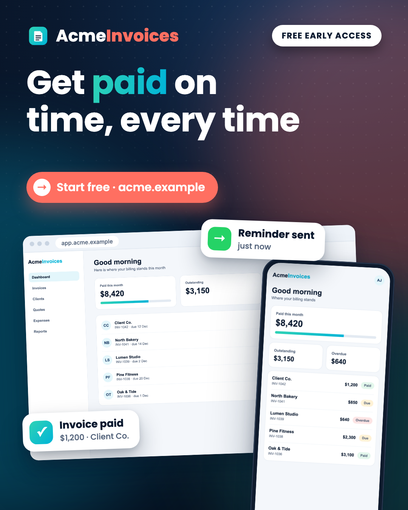
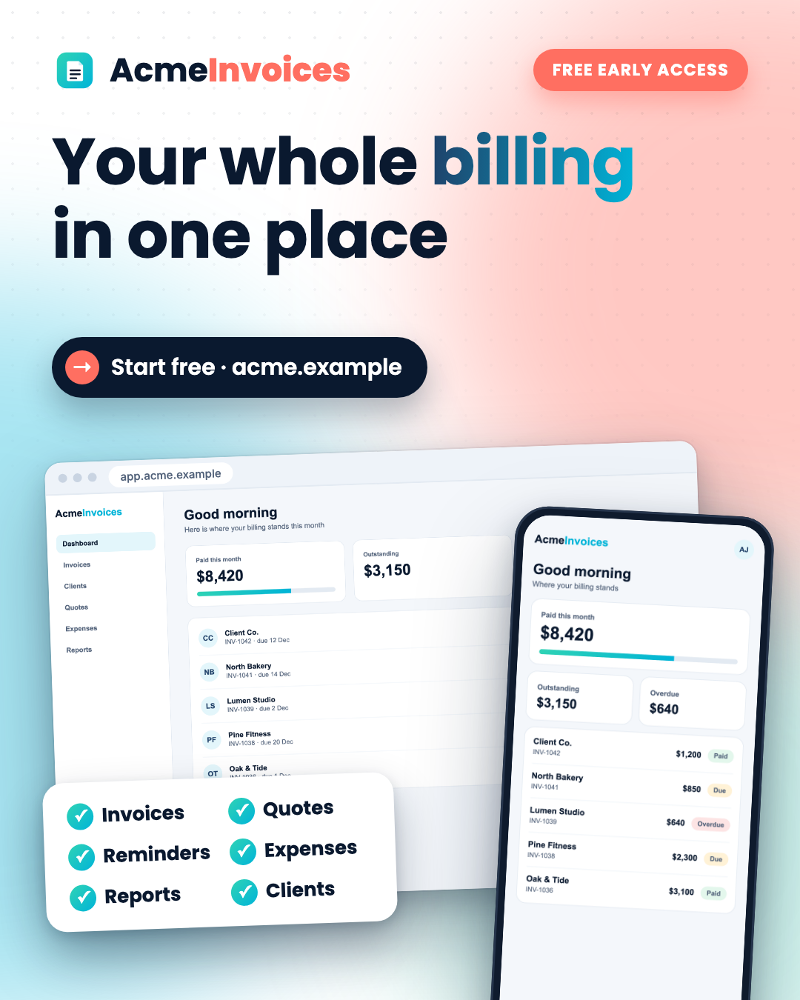
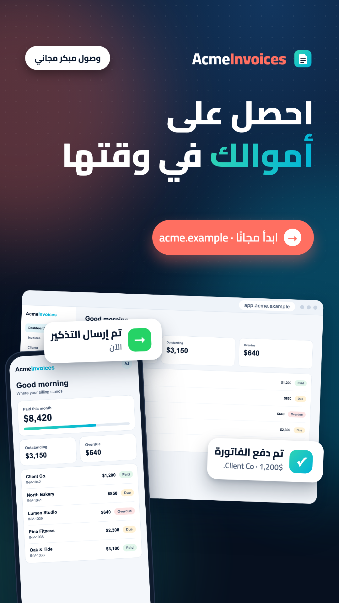

# meta-ads-launch

**A Claude skill that takes any app or small-business product from "I have never run an ad" to a first Meta (Facebook + Instagram) ad test on a small budget.**

It prepares what can be prepared and teaches the rest, one small step at a time:

- **Tracking** - Meta Pixel for a marketing site and a single-page or Flutter web app, with sign-up and first-use events counted once, and the privacy wording that goes with it.
- **Creatives** - feed, square, story and link images in any number of languages (right-to-left included), plus a profile picture and cover photo, drawn from screenshots of your real product.
- **Copy** - primary text, headline, description, button and a UTM tracking link, as patterns you fill in.
- **A beginner walkthrough** - accounts, campaign, ad set, ad, publish and how to read the first 48 hours, written as short steps that ask for a screenshot before the next one, including the traps hit on a real first run.
- **Guardrails** - it never spends money, accepts terms or publishes for you. You click those.

<p align="center">
  
  
  
</p>
<p align="center"><sub>Generated by <code>scripts/make_creatives.py</code> from a JSON file and two screenshots. Product, brand and numbers are fictional.</sub></p>

## Install

The skill is a folder. Put it where your agent loads skills.

**Claude Code**

```bash
git clone https://github.com/nowfalvaasits/meta-ads-launch ~/.claude/skills/meta-ads-launch
```

(for one project only, clone it into `<project>/.claude/skills/meta-ads-launch`).

**Other agents:** copy `SKILL.md`, `references/`, `scripts/` and `templates/` into the folder your agent reads skills from. `SKILL.md` is the entry point and the other files are read on demand.

**For the image script** you need Python 3, Google Chrome or Chromium (set `CHROME=/path/to/chrome` if it is not found automatically), and internet access for the web fonts. No Python packages are required.

## Use

Ask in plain words:

> "Set up a small Meta ad test for my app. It is an invoicing tool for freelancers, I want to start in Spain, budget about 25 dollars a day."

> "Add the Meta Pixel and a sign-up event to my site and web app."

> "I am confused at the ad set screen, here is a screenshot."

The agent inspects your product, asks a few questions (buyer, country, languages, budget, what accounts exist), then works through tracking, creatives, copy and the campaign build with you. Full tutorial: [docs/getting-started.md](docs/getting-started.md).

### Make the images yourself

```bash
cp -R examples my-ads && cd my-ads          # start from the working example
python3 ../scripts/make_creatives.py ads.json            # every ad, language and shape
python3 ../scripts/make_creatives.py ads.json --lang en --only launch
python3 ../scripts/make_creatives.py ads.json --page     # profile picture and cover photos
```

You supply screenshots of your own product (a desktop browser window and a phone screen) and edit `ads.json`. Every option is in [docs/config-reference.md](docs/config-reference.md).

## What is in the box

```
SKILL.md                      workflow, rules, lessons from a first run (entry point)
references/
  campaign-walkthrough.md     accounts -> campaign -> ad set -> ad -> publish -> read results
  tracking.md                 pixel code, events, privacy wording, verification
  creative-specs.md           sizes, safe zones, what goes on an ad, copy rules
  compliance.md               special ad categories, local rules, policies (verify at the source)
scripts/make_creatives.py     ad images and page assets from a JSON config (headless Chrome)
templates/                    ads.example.json and copy patterns to fill in
examples/                     a complete worked example with fictional screens and its output
docs/                         getting started, config reference, how it works
```

## Why it exists

A first Meta ad test fails for boring reasons: the wrong data source in Events Manager, a schedule that is too short, AI "enhancements" that invent a stock photo of a person holding a phone, one image stretched to every placement, a pixel that never fires on sign-up. This skill encodes the order that works and the traps, so a first-time advertiser can get a clean test live in an afternoon.

## Honesty

Costs, special-category rules and local advertiser rules mentioned here come from third-party articles that disagree with each other. Check each at the official source before spending. The skill says the same to the user.

## Author

Built by **Nowfal** from a real launch. Portfolio: [nowfal.in](https://nowfal.in).

## Licence

MIT. See [LICENSE](LICENSE).
